<picture>
  <source media="(prefers-color-scheme: dark)" srcset="assets/hero-dark.svg">
  
</picture>

I'm a PhD candidate at the Faculty of Computing and Informatics, Multimedia University, and a Graduate Research Assistant at TM R&D. My work is on **post-quantum verifiable federated learning**: many parties train one model together, each can check that the result is correct, and the guarantees hold even against an adversary with a quantum computer.

### Research

- **Post-quantum verifiable federated learning.** My PhD. Code and papers will be published here once they clear review.

### Tools

Python, Rust, Go and TypeScript. PyTorch for learning systems. ML-KEM and ML-DSA (FIPS 203 and 204) for the post-quantum side. Linux, Docker and GitHub Actions for everything around it.

### Elsewhere

[LinkedIn](https://www.linkedin.com/in/thabit-mahmood/) · [ORCID](https://orcid.org/0009-0003-3909-3427)
