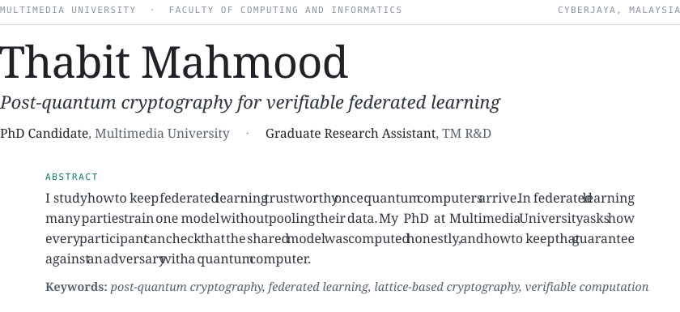
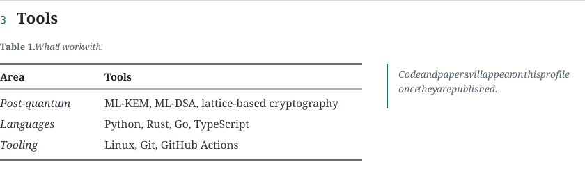
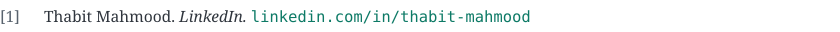

<picture>
  <source media="(prefers-color-scheme: dark)" srcset="assets/title-dark.svg">
  
</picture>

<picture>
  <source media="(prefers-color-scheme: dark)" srcset="assets/s1-dark.svg">
  
</picture>

<picture>
  <source media="(prefers-color-scheme: dark)" srcset="assets/s2-dark.svg">
  
</picture>

<picture>
  <source media="(prefers-color-scheme: dark)" srcset="assets/s3-dark.svg">
  
</picture>

<picture>
  <source media="(prefers-color-scheme: dark)" srcset="assets/refs-dark.svg">
  
</picture>

<a href="https://www.linkedin.com/in/thabit-mahmood/"><picture>
  <source media="(prefers-color-scheme: dark)" srcset="assets/ref1-dark.svg">
  
</picture></a> 
<a href="https://orcid.org/0009-0003-3909-3427"><picture>
  <source media="(prefers-color-scheme: dark)" srcset="assets/ref2-dark.svg">
  
</picture></a>

<picture>
  <source media="(prefers-color-scheme: dark)" srcset="assets/colophon-dark.svg">
  
</picture>

