<p align="center">
  <br>
  <br>
  <br>
  <br>
  
</p>

<p align="center">
  <a href="https://www.linkedin.com/in/thabit-mahmood/"></a>&nbsp;&nbsp;
  <a href="https://orcid.org/0009-0003-3909-3427"></a>
</p>

<details>
<summary><b>Verify this profile</b></summary>
<br>

The facts on this page live in [`identity/identity.json`](identity/identity.json), signed with **ML-DSA-65** (FIPS 204, NIST's post-quantum signature standard). A GitHub Action re-checks the signature every night and redraws the last frame from the result, so the date under the seal is the last time it actually verified.

```sh
git clone https://github.com/Thabit-Mahmood/Thabit-Mahmood && cd Thabit-Mahmood
pip install --upgrade cryptography
python3 verify.py
```

`verify.py` uses pyca/cryptography, or the independent pure-Python dilithium-py if your cryptography predates ML-DSA. Change one character of the record and verification fails. The guilloché seal is drawn from the signing key's fingerprint, so a different key would draw a different seal.

</details>
