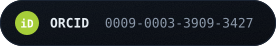

  

  

  

  

  

  

  

  Every graphic here is hand-written SVG with its own embedded font and no third-party services. 
  The contribution lattice is re-rendered each night by <a href=".github/workflows/lattice.yml">a GitHub Action</a> from my live calendar.

