<p align="center">
  <picture>
    <source media="(prefers-color-scheme: dark)" srcset="assets/credential-dark.svg">
    
  </picture>
</p>

<p align="center">
  <picture>
    <source media="(prefers-color-scheme: dark)" srcset="assets/record-dark.svg">
    
  </picture>
</p>

<p align="center">
  <a href="https://www.linkedin.com/in/thabit-mahmood/"><picture><source media="(prefers-color-scheme: dark)" srcset="assets/linkedin-dark.svg"></picture></a>&nbsp;&nbsp;
  <a href="https://orcid.org/0009-0003-3909-3427"><picture><source media="(prefers-color-scheme: dark)" srcset="assets/orcid-dark.svg"></picture></a>
</p>

<details>
<summary><b>Verify this profile</b></summary>
<br>

The credential is a real signed statement. [`identity/identity.json`](identity/identity.json) holds the facts on the card, signed with **ML-DSA-65** (FIPS 204, NIST's post-quantum signature standard). The public key and signature sit next to it. `verify.py` checks them with pyca/cryptography, or with the independent pure-Python dilithium-py if your cryptography predates ML-DSA. Change one character of the record and verification fails.

```sh
git clone https://github.com/Thabit-Mahmood/Thabit-Mahmood && cd Thabit-Mahmood
pip install --upgrade cryptography
python3 verify.py
```

</details>
